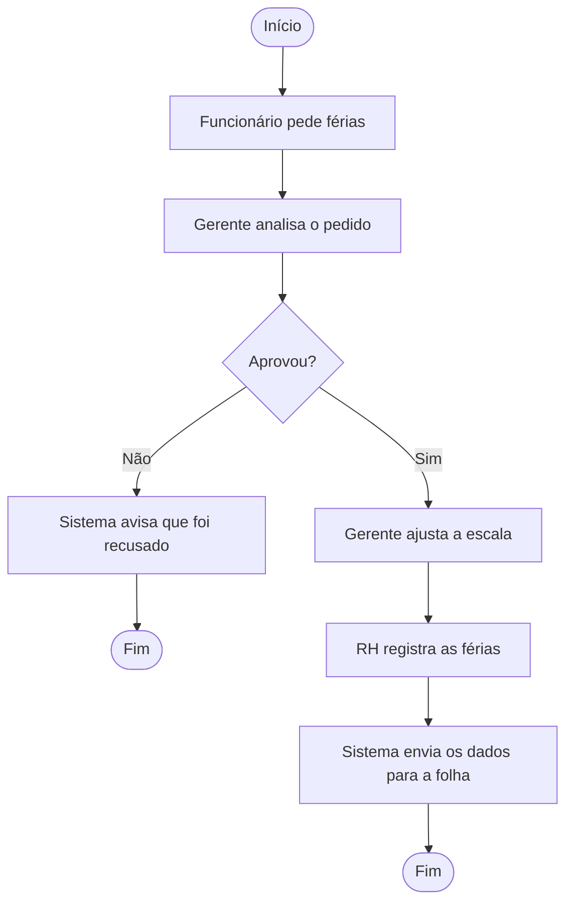
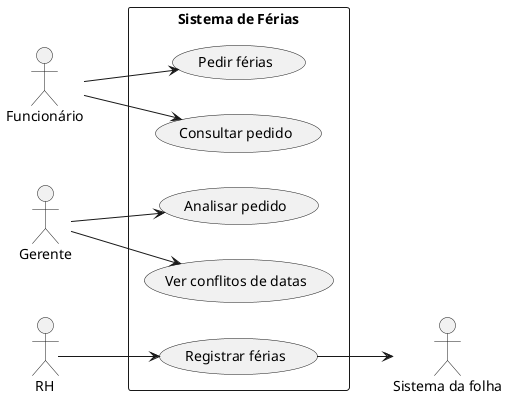

# Sistema de Pedido de Férias

## 1. Escopo

A ideia é facilitar o pedido de férias dos funcionários. Hoje, eles podem fazer o pedido em papel e precisam perguntar ao gerente para saber a resposta. Com o sistema, poderão pedir e acompanhar as férias pelo celular.

**O sistema vai fazer:**
- Permitir que o funcionário peça férias e veja a resposta.
- Permitir que o gerente aprove ou recuse o pedido.
- Mostrar ao gerente se outras pessoas da equipe já terão férias na mesma época.
- Permitir que o RH registre as férias aprovadas.

**O sistema não vai fazer:**
- Montar a escala de trabalho da loja.
- Calcular ou realizar o pagamento das férias.

## 2. Processo

Primeiro, o funcionário faz o pedido e o gerente analisa. Se não aprovar, o sistema avisa o funcionário. Se aprovar, o gerente ajusta a escala e o RH registra as férias.

## 3. Personas

**Marina — funcionária:** trabalha na loja e usa o celular no dia a dia. Quer pedir férias sem preencher papel e consultar a resposta sem precisar perguntar ao gerente.

**Ricardo — gerente:** cuida da equipe e precisa saber quem já vai sair de férias. Quer analisar os pedidos sem deixar a loja com poucos funcionários.

**Cláudia — RH:** cuida dos registros dos funcionários. Quer registrar as férias aprovadas sem precisar digitar as mesmas informações várias vezes.

## 4. Diagrama de casos de uso

## 5. Caso de uso: Pedir férias

**Quem usa:** Funcionário  
**Quando:** Quando quiser marcar as férias.  
**Antes de começar:** Precisa entrar no sistema com seu usuário.  
**Resultado:** O pedido fica salvo e o gerente recebe um aviso.

**Passos normais**
1. O funcionário escolhe a opção de pedir férias.
2. O sistema mostra quantos dias de férias ele tem.
3. O funcionário informa a data e a quantidade de dias.
4. O sistema confere se ele tem dias suficientes e se o pedido segue as regras.
5. O sistema mostra um resumo.
6. O funcionário confirma.
7. O sistema salva o pedido e avisa o gerente.

**Outra possibilidade — vender parte das férias**
- Ao preencher o pedido, o funcionário pode informar que quer vender um terço das férias.
- O sistema calcula quantos dias serão de descanso e quantos serão vendidos.
- Depois, continua a conferência do pedido.

**Problema — dias insuficientes**
- Se o funcionário pedir mais dias do que tem disponíveis, o sistema avisa quantos dias ele possui.
- O funcionário pode corrigir o pedido.

**Cancelamento**
- Se o funcionário desistir antes de confirmar, o pedido não será salvo.

## 6. Histórias e critérios de aceitação

**História 1:** Como funcionário, quero pedir férias pelo celular para não precisar usar papel.

| Situação | O que deve acontecer |
|---|---|
| Tenho dias suficientes e confirmo o pedido | O sistema salva o pedido e avisa o gerente |
| Tenho 10 dias e peço 15 | O sistema avisa que não tenho dias suficientes |
| Desisto antes de confirmar | O sistema não salva o pedido |

**História 2:** Como funcionário, quero consultar meus pedidos para saber se foram aprovados.

| Situação | O que deve acontecer |
|---|---|
| Abro meus pedidos | Vejo as datas e o estado de cada pedido |
| Meu pedido foi recusado | Consigo ver o motivo |

**História 3:** Como gerente, quero ver os pedidos e as datas de férias da equipe para organizar a loja.

| Situação | O que deve acontecer |
|---|---|
| Abro um pedido | Vejo se outras pessoas estarão de férias no mesmo período |
| Recuso um pedido sem explicar o motivo | O sistema pede que eu informe o motivo |

**História 4:** Como pessoa do RH, quero registrar as férias aprovadas para não precisar digitar tudo novamente.

| Situação | O que deve acontecer |
|---|---|
| Registro as férias aprovadas | Os dados são enviados ao sistema da folha |

## 7. Regras de negócio

| Regra | Explicação | Origem |
|---|---|---|
| Divisão das férias | As férias podem ser divididas em até três períodos. Um deles deve ter pelo menos 14 dias e os outros, pelo menos 5 dias. | Material da aula — CLT, art. 134 |
| Venda de férias | O funcionário pode vender até um terço das férias. | Material da aula — CLT, art. 143 |
| Recusa do pedido | O gerente precisa explicar por que recusou o pedido. | Regra da empresa |
